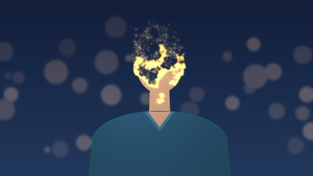
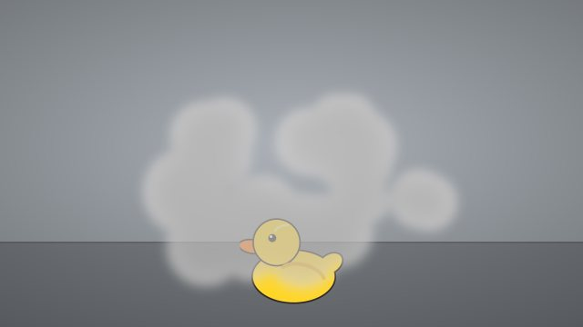
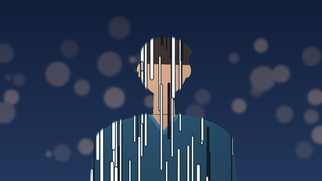
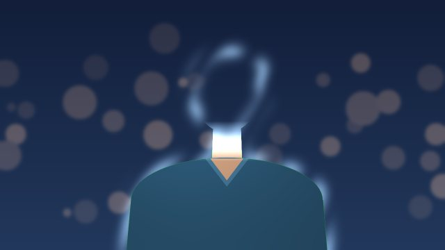
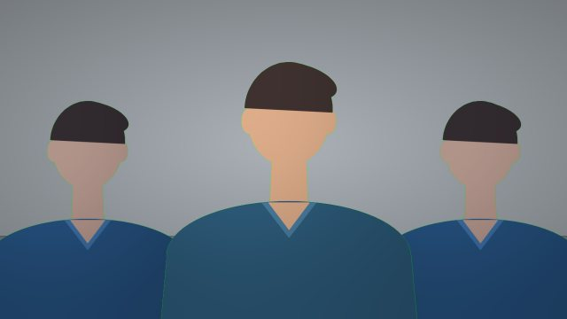
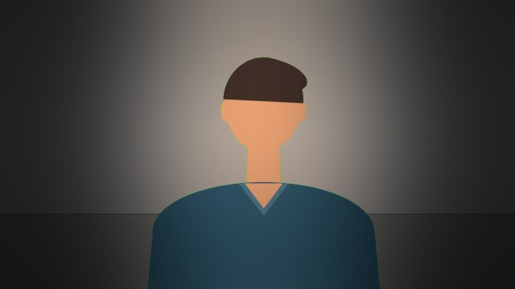
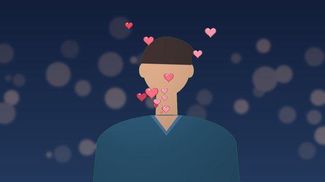
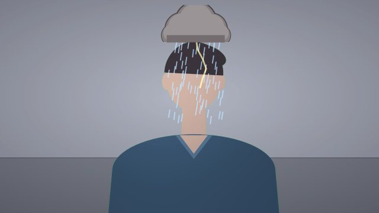

<p align="center"></p>

<h1 align="center">Hocus</h1>

<p align="center"><b>Now you see me.</b> Make a hand sign and vanish from your webcam, live, in Teams, Zoom or Google Meet.</p>

<p align="center">
  
  
  
  <a href="https://github.com/harshitrastogi992/hocus/releases/latest"></a>
  
</p>

<p align="center"></p>

Hocus is a desktop app that watches your hands and plays effects on your camera feed. Burn away into sparks, swap places with a rubber duck, summon shadow clones or fire confetti with a thumbs up. Every effect has its own gesture, they all run at once, and the result goes straight into your meeting app through a virtual camera.

Everything runs on your computer. Your video never leaves the machine except through the virtual camera you choose to use.

> Screenshots use a drawn placeholder person from the engine's demo mode. In the app, it is you.

## Download

Get the latest version from the **[releases page](https://github.com/harshitrastogi992/hocus/releases/latest)**.

| System | File |
|---|---|
| macOS 12+ on Apple Silicon | `Hocus_<version>_aarch64.dmg` |
| Windows 10 or 11, 64-bit | `Hocus_<version>_x64-setup.exe` |

The installers are not yet signed, so macOS and Windows warn you the first time you open Hocus. The release notes show how to get past the warning in a few clicks. Intel Macs are not covered by the installers yet; build from source instead.

## Effects

Nine effects in three kinds. Switch on any combination; each gesture belongs to one effect at a time.

### Vanish

Make the gesture to disappear. Make it again to come back.

<table>
  <tr>
    <td width="33%"></td>
    <td width="33%"></td>
    <td width="33%"></td>
  </tr>
  <tr>
    <td><b>Stardust</b> · V sign<br>Burn away, top to bottom, into drifting amber sparks.</td>
    <td><b>Switcheroo</b> · Palms together<br>A puff of smoke, and a rubber duck takes your seat.</td>
    <td><b>Blink</b> · Forehead tap, 1 s<br>Comic speed lines, a beam of light, gone.</td>
  </tr>
  <tr>
    <td></td>
    <td></td>
    <td></td>
  </tr>
  <tr>
    <td><b>Cloak</b> · Open palm, 1 s<br>Invisible, apart from a faint ripple of glass.</td>
    <td></td>
    <td></td>
  </tr>
</table>

### Modes

Stay in view. Make the gesture to switch a mode on, and again to switch it off.

<table>
  <tr>
    <td width="50%"></td>
    <td width="50%"></td>
  </tr>
  <tr>
    <td><b>Clones</b> · Crossed fingers<br>Two shadow clones copy your moves a beat late.</td>
    <td><b>Spotlight</b> · Finger up, 0.8 s<br>The room dims and a stage light follows you.</td>
  </tr>
</table>

### Reactions

Play once, any time. Reactions need no background, so they work from the moment the camera is on.

<table>
  <tr>
    <td width="33%"></td>
    <td width="33%"></td>
    <td width="33%"></td>
  </tr>
  <tr>
    <td><b>Confetti</b> · Thumbs up<br>Party poppers fire from both corners, behind you.</td>
    <td><b>Hearts</b> · Heart hands<br>A heart pops out of your hands and more float up.</td>
    <td><b>Rain cloud</b> · Thumbs down<br>A storm cloud follows your head. One thunderclap.</td>
  </tr>
</table>

Every effect has its own synthesised sound, played on your computer only. Meeting guests hear your microphone as usual.

## The app

<p align="center"></p>

<table>
  <tr>
    <td width="33%"></td>
    <td width="33%"></td>
    <td width="33%"></td>
  </tr>
  <tr>
    <td><b>Start-up checks</b><br>System, vision models, camera permission and the meeting driver, checked on every launch.</td>
    <td><b>Backgrounds</b><br>Vanish into your real room, a built-in backdrop or your own image.</td>
    <td><b>Meeting setup</b><br>Installs OBS for you and walks through Teams, Zoom and Meet.</td>
  </tr>
</table>

## Get started

1. **Install and open Hocus.** The start-up screen checks your system and the vision models, and asks for camera access.
2. **Pick a background.** Under **Background**, either capture your empty room (step out of view for a few seconds) or choose a backdrop. Vanishing needs one; reactions do not.
3. **Try an effect.** Each card in **Effects** has a **Try** button. Then make the gesture itself: a V sign for Stardust, a thumbs up for Confetti.
4. **Go live.** Open **Output > Set up meeting apps**, follow the four steps, and choose **OBS Virtual Camera** in your meeting app.

The full walkthrough, gesture tips and troubleshooting are in the **[user guide](docs/guide.md)**.

### Gesture cheat sheet

| Gesture | How to make it | Default effect |
|---|---|---|
| V sign | Index and middle finger up and apart | Stardust |
| Palms together | Both open hands pressed together, fingers up | Switcheroo |
| Forehead tap | Index and middle finger together on your forehead, hold 1 s | Blink |
| Open palm | One flat hand raised, fingers up, hold 1 s | Cloak |
| Crossed fingers | Index fingers of both hands crossed in a plus sign | Clones |
| Finger up | Index finger pointing up, other fingers folded, hold 0.8 s | Spotlight |
| Thumbs up | Fist with the thumb up, away from your face | Confetti |
| Heart hands | Index tips touching at the top, thumbs at the bottom | Hearts |
| Thumbs down | Fist with the thumb down, away from your face | Rain cloud |

Any gesture can be reassigned per effect. Hocus will not let two switched-on effects share one.

## Requirements

- macOS 12 or later (Apple Silicon or Intel), or Windows 10 or 11, 64-bit
- A webcam
- [OBS Studio](https://obsproject.com) 30 or later, only for sending video to meeting apps (Hocus can install it for you)

Installers cover Apple Silicon Macs and 64-bit Windows. On an Intel Mac, build from source as below.

## Privacy

No accounts, no analytics, no cloud. The installers include the vision models, so Hocus itself makes no network calls; the optional **Install OBS** button uses Homebrew or winget. A build from source downloads the models once from Google's MediaPipe model storage. The engine listens on `127.0.0.1` only and requires a random token generated at each launch.

## Development

Two parts: a Python engine that does the vision and video work, and a Tauri desktop app that provides the window and UI. They talk over a local WebSocket ([protocol](docs/protocol.md), [architecture](docs/architecture.md)).

```
hocus/
├── engine/                 Python package `hocus`
│   ├── src/hocus/
│   │   ├── vision/         MediaPipe models, segmentation, hand and face landmarks
│   │   ├── gestures/       Hand-shape tests, gesture catalogue, hold timer
│   │   ├── effects/        Vanishing effects and modes, one module each
│   │   ├── reactions/      One-shot reactions (confetti, hearts, rain cloud)
│   │   ├── director.py     When to leave and come back
│   │   ├── engine.py       Camera -> vision -> effects -> preview and virtual camera
│   │   ├── demo.py         Drawn placeholder person for screenshots
│   │   ├── server.py       Local WebSocket for the UI
│   │   └── settings.py     Validated, persisted settings
│   └── tests/
├── app/                    Tauri 2 + React + TypeScript + Tailwind
│   ├── src/                UI
│   └── src-tauri/          Rust shell that starts the engine
├── scripts/                Sidecar build, effect previews, README media
└── docs/                   User guide, architecture, protocol, adding an effect, roadmap
```

### Prerequisites

- Python 3.13 (3.11 and 3.12 also work)
- Node.js 20 or later and pnpm
- Rust (stable) and the [Tauri prerequisites](https://v2.tauri.app/start/prerequisites/) for your OS

### Run in development

```bash
# Engine
python3.13 -m venv engine/.venv
engine/.venv/bin/pip install -e "engine[dev]"     # Windows: engine\.venv\Scripts\pip

# App
cd app
pnpm install
pnpm tauri dev
```

In development the app starts the engine from `engine/.venv`. Set `HOCUS_PYTHON` to use a different interpreter.

### Tests

```bash
engine/.venv/bin/pytest engine                                   # engine unit and protocol tests
(cd engine && .venv/bin/ruff check src tests ../scripts)         # lint, as CI runs it
cd app && pnpm typecheck
engine/.venv/bin/python scripts/preview_effects.py /tmp/previews # effect strips and ms per frame
```

### Demo mode and README media

`python -m hocus serve --demo` replaces the camera with a drawn placeholder person, so the app can be shown and screenshotted without anyone on camera. `scripts/render_readme_media.py` renders the gallery and hero animation in `docs/images/` through the real effect pipeline.

### Build an installer

```bash
engine/.venv/bin/python scripts/build_engine.py       # freezes the engine into app/src-tauri/binaries/
cd app && pnpm tauri build --config src-tauri/tauri.release.conf.json
```

Installers for public release must be signed: an Apple Developer ID with notarisation on macOS, and a code-signing certificate on Windows. Unsigned builds work but show security warnings.

### Contributing an effect

See [adding an effect](docs/adding-an-effect.md). Effects are drawn in code (no image or sound files) and should stay under about 15 ms per 720p frame. Ideas waiting for an owner are on the [roadmap](docs/roadmap.md).

## Credits

Built with [MediaPipe](https://developers.google.com/mediapipe) (Apache 2.0), [OpenCV](https://opencv.org), [pyvirtualcam](https://github.com/letmaik/pyvirtualcam), [Tauri](https://tauri.app) and [Lucide](https://lucide.dev) icons. All effect art and sounds are generated in code.

## Licence

[MIT](LICENSE)
