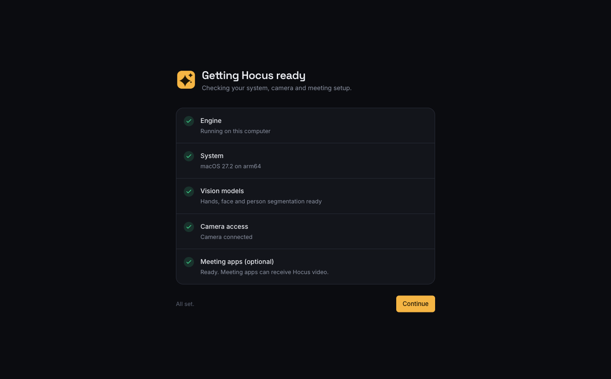
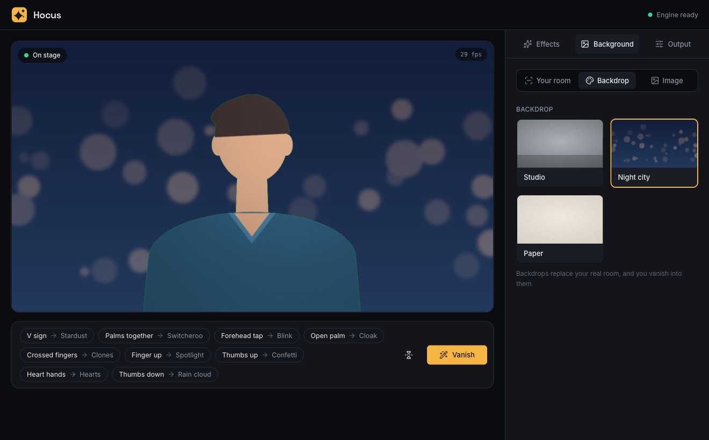
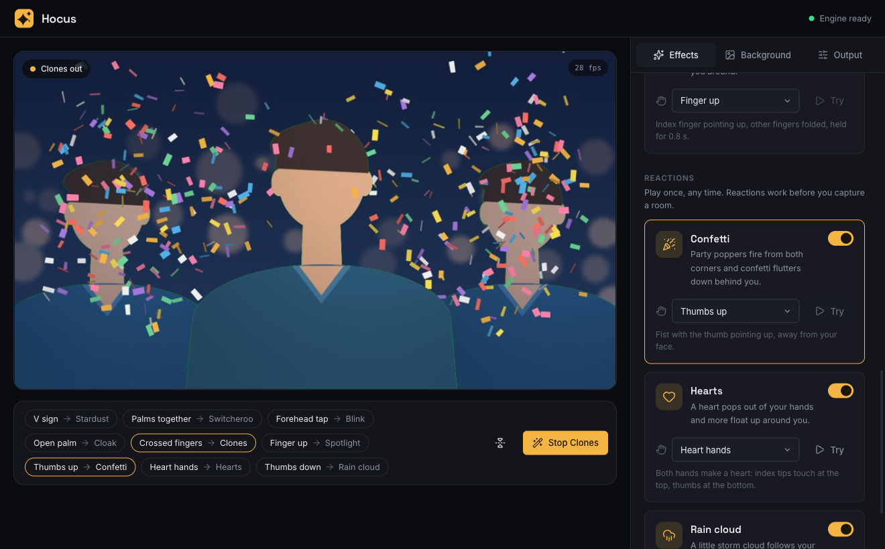
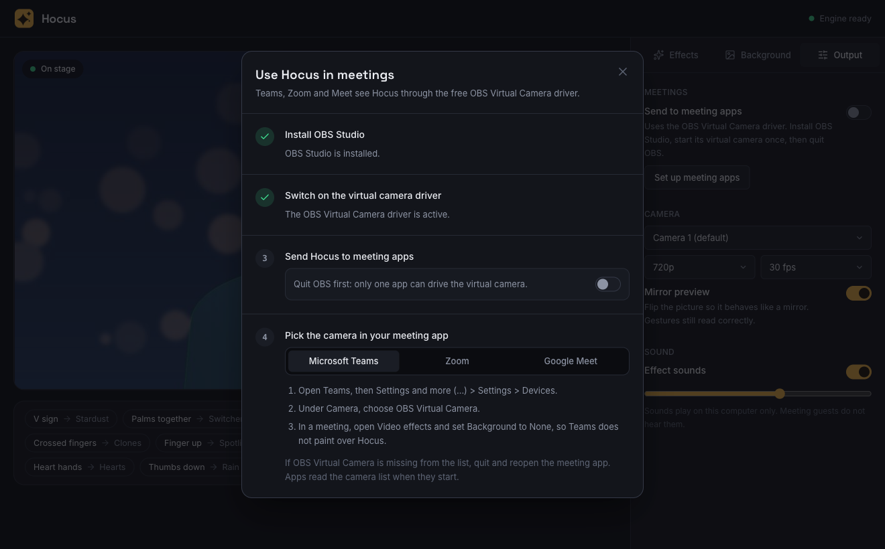

# Hocus user guide

From first launch to your first vanish in a Teams, Zoom or Google Meet call. Allow about ten minutes, most of it for the one-time OBS setup.

## 1. First launch

Hocus checks five things every time it opens:

| Check | What it means | If it fails |
|---|---|---|
| Engine | The vision engine started on this computer | Use **Restart**. If it keeps failing, the error text shows why. |
| System | macOS 12+ or Windows 10/11, 64-bit | Hocus needs a supported system. |
| Vision models | Hand, face and person models are present | The installers include them. A build from source downloads about 12 MB on first launch, so check your internet connection. |
| Camera access | Hocus can read your webcam | Use **Open camera settings**, allow Hocus, then restart it. Close other apps using the camera. |
| Meeting apps | The OBS Virtual Camera driver is installed | Optional. Needed only to send video to meeting apps. See step 5. |

When everything passes, Hocus continues on its own. **Continue anyway** lets you in without the optional check.

## 2. Choose a background

To make you vanish, Hocus has to know what is behind you. Open **Background** and pick one:

- **Your room.** Click **Capture room**, step fully out of view during the 3-second countdown, and stay out for about 2 seconds. You then vanish into your real surroundings. Recapture if you move the camera or the light changes a lot.
- **Backdrop.** Studio, Night city or Paper. You are cut out and placed in front of it, and vanish into it.
- **Image.** Any PNG, JPEG or WebP, such as a company background.

Reactions (confetti, hearts, rain cloud) work without a background.

## 3. Choose your effects

The **Effects** panel lists every effect in three groups:

- **Vanish**: you disappear and come back with the same gesture.
- **Modes**: you stay in view; the gesture switches the mode on and off.
- **Reactions**: play once and finish on their own.

For each effect you can:

- switch it on or off;
- change its gesture from the drop-down. A gesture already used by another switched-on effect is marked and cannot be picked;
- press **Try** to play it without a gesture.

The bar under the preview shows your live gesture map. The **Vanish** button there vanishes with your first vanishing effect, and changes to **Reappear** or **Stop** while an effect is active.

## 4. Make the gestures

| Gesture | How | Hold | Tips |
|---|---|---|---|
| V sign | Index and middle finger up and spread, other fingers folded | Instant | Away from your forehead, or it is ignored. |
| Palms together | Both open hands pressed flat together, fingers up | 0.25 s | Keep both hands in frame. |
| Forehead tap | Index and middle finger together, tips on your forehead | 1 s | Your face must be visible. A ring shows progress. |
| Open palm | One flat hand raised, fingers together and pointing up | 1 s | A quick wave does not trigger it. |
| Crossed fingers | Index fingers of both hands crossed in a plus sign | 0.25 s | Cross near the middle of the fingers. |
| Finger up | Index finger straight up, other fingers folded | 0.8 s | Like asking for a moment. |
| Thumbs up | Fist with the thumb pointing up | 0.3 s | Hold it away from your face; a fist on your chin is ignored. |
| Heart hands | Index tips touching at the top, thumbs touching at the bottom | 0.3 s | Leave a gap in the middle of the heart. |
| Thumbs down | Fist with the thumb pointing down | 0.3 s | Away from your face, with the other hand clear of it. |

After an effect plays, lower your hand before making the gesture again. This stops a hand that is still raised from triggering twice.

**For reliable detection:** face a light source, keep your hands inside the frame at chest height or above, and sit about an arm's length from the camera.

## 5. Use Hocus in a meeting

Meeting apps receive Hocus through the free OBS Virtual Camera driver. Open **Output > Set up meeting apps** and follow the steps:

1. **Install OBS Studio.** **Install OBS** does it for you, with Homebrew on macOS or winget on Windows. Or use **Download page**.
2. **Switch on the driver.** Click **Open OBS**, then **Start Virtual Camera** and **Stop Virtual Camera** in OBS, and quit OBS. On macOS, allow the OBS system extension if asked, in System Settings > General > Login Items & Extensions.
3. **Send Hocus to meeting apps.** Switch it on. Keep OBS closed: only one app can drive the virtual camera.
4. **Pick the camera in your meeting app.** Choose **OBS Virtual Camera**, and turn off the meeting app's own background blur or effects, or they will paint over Hocus.

| App | Where to choose the camera | Turn off |
|---|---|---|
| Microsoft Teams | Settings and more (…) > Settings > Devices > Camera | Video effects > Background: None |
| Zoom | Settings > Video > Camera | Background & effects: None |
| Google Meet | More options (⋮) > Settings > Video > Camera | Visual effects |

Meeting apps mirror your own preview. Everyone else sees you the right way round.

## 6. Settings worth knowing

Under **Output**:

- **Camera, resolution and frame rate.** 720p at 30 fps suits most computers. Drop to 480p on older machines.
- **Mirror preview.** Flips the picture like a mirror. Gestures read correctly either way.
- **Effect sounds and volume.** Sounds play on your computer only.

Settings are saved automatically and restored on the next launch.

## Troubleshooting

| Problem | Fix |
|---|---|
| "No camera picture" | Another app may be using the camera. Close it, or choose another camera under **Output**. Check camera permission for Hocus. |
| Vanish does nothing | Capture your room or choose a backdrop first. The banner over the preview says when this is missing. |
| A gesture does not trigger | Check that the effect is switched on and which gesture it uses. Improve the lighting and keep the whole hand in frame. |
| An effect triggers by accident | Switch it off, or move it to a gesture with a hold time, such as Open palm or Forehead tap. |
| Bits of the chair or room appear around you | Sit slightly forward, away from the chair back, and recapture the room with even lighting. |
| OBS Virtual Camera missing in the meeting app | Quit and reopen the meeting app; apps read the camera list when they start. Check that step 2 of meeting setup shows a tick. |
| "Send to meeting apps" shows an error | Quit OBS if it is open, then switch it off and on again. |
| The meeting shows a blurred or replaced background over Hocus | Turn off the meeting app's own background effects. |
| Slow or jerky preview | Lower the resolution to 480p or the frame rate to 24 fps under **Output**. |

## Privacy

Hocus has no accounts and sends nothing to the internet. Builds from source download the vision models once, and **Install OBS** downloads OBS through Homebrew or winget. Video stays on your computer; it only leaves through the virtual camera when you switch on **Send to meeting apps**.
